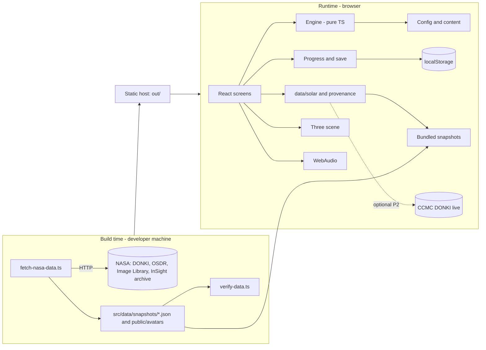
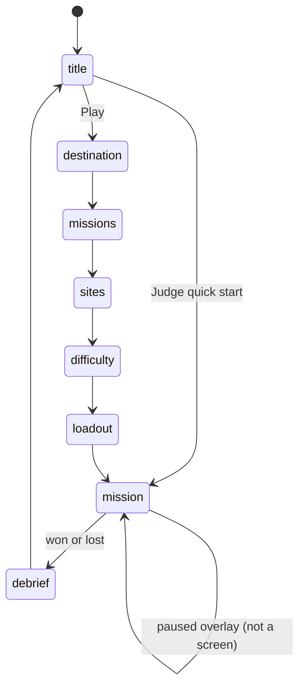
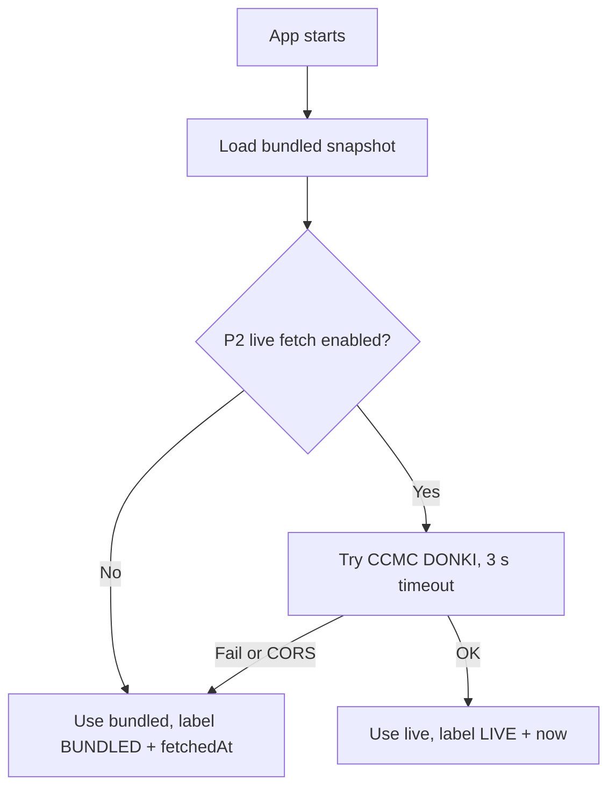

# Technical Documentation - Junior Astronaut Mission Trainer

Place this file at `docs/TECHNICAL.md`. Version 1.0 (hackathon build).
Companions: `SPEC.md` (rules, formulas, task cards; the source of truth for implementation) and `README.md` (judge-facing).
Where this file and `SPEC.md` disagree on a rule or number, `SPEC.md` wins. Where they disagree on structure, fix both in the same PR.

> **v1.1 amendments.** Presentation (persistent 3D stage, cinematics, companion dialogues, interface rules) is specified in `docs/spec/PRESENTATION.md`; the expanded NASA data catalog in `docs/spec/DATA-CATALOG.md`. They take precedence. Layout changes: `src/three/{stage,kit,cinematics}`, `src/ui/{dialog,cinematics}`, `src/engine/playback.ts`, `src/content/{dialogues,guide}.ts`, `public/sites/`. `three/` may import `engine/types` and `content/`; `audio/` is owned by D; judge mode UI by B. Snapshot names follow DATA-CATALOG. The save schema gains `seen` and `settings.speed`.

Tags: **[REAL]** = from a NASA source with provenance. **[GAME]** = our design rule.

---

## 1. System overview

A static web app. There is no server. Two phases exist:

- **Build time** (developer machine): a Node script fetches NASA data once and writes trimmed JSON snapshots into the repo.
- **Runtime** (child's browser): React UI on top of a pure-TypeScript game engine, bundled snapshots, `localStorage` for progress.



Why static: the challenge asks for a game judges can open with no download or account. A server would add deployment risk and no benefit in 24 hours.

---

## 2. Frontend and "backend" responsibilities

| Area | Responsibility |
|---|---|
| Frontend (browser) | Screens and navigation, game engine execution, timers, input (mouse, touch, keyboard), rendering (React, SVG, Three), audio, progression, save and restore, provenance display, judge mode |
| Build-time pipeline (our only back-end role) | Fetch NASA data, trim it, attach provenance, download avatars, verify integrity, fail the build on missing provenance or unverified facts |
| Hosting | Serve the static `out/` directory over HTTPS |
| Not present | Server code, database, API routes, accounts, analytics, tracking, third-party scripts or fonts |

An optional backend would only be justified for a shared leaderboard or classroom reports. Both are out of scope for v1.

---

## 3. Layers and dependency rules

| Layer (folder) | May import from |
|---|---|
| `engine/` | `engine/` only. No React, no DOM, no `Date`, no `Math.random` |
| `content/` | `engine/types` only |
| `progress/` | `engine/types`, `content/badges` |
| `data/` | `engine/types` |
| `ui/` | `engine`, `content`, `progress`, `data`, `audio`, `three` (via dynamic import) |
| `three/`, `audio/` | `engine/types` only |
| `judge/` | `engine`, `data`, `content` |
| `scripts/` | `engine/types`, Node APIs |

Enforcement: ESLint `no-restricted-imports` per folder, plus `tests/architecture.test.ts`, which reads source files and fails if `engine/` contains `Math.random`, `Date.`, `window`, `document`, `localStorage`, or an import from `react`.

---

## 4. Module breakdown

| Module | Public API | Owner | Main tests |
|---|---|---|---|
| `engine/types.ts` | all shared types (contract, frozen at T+1) | A | compile only |
| `engine/rng.ts` | `mulberry32(seed)`, `pickWeighted(rng, items)` | A | determinism |
| `engine/config/balance.ts`, `difficulty.ts` | constants only | A | shape and range checks |
| `engine/reducer.ts` | `createRun(params, solar)`, `resolveStep(state, action, solar)` | A | rules, clamping, events, caps |
| `engine/scoring.ts` | `scoreRun(state)` | A | stars and XP edges |
| `engine/bots.ts` | `randomBot`, `greedyPowerBot`, `balancedBot` (dev only) | A | balance targets |
| `content/*` | `MISSIONS`, `SITES`, `ARCHETYPES`, `EVENT_TEXT`, `GUIDE_LINES`, `BADGES` | D | schema and length limits |
| `progress/xp.ts` | `missionXp(score, streakCount)` | D | XP table |
| `progress/ranks.ts` | `rankForXp(xp)` | D | edges 499/500 etc. |
| `progress/streak.ts` | `updateStreak(streak, today)` (today injected) | D | joker, gap, same-day |
| `progress/badgesLogic.ts` | `evaluateBadges(save, result)` | D | each badge condition |
| `progress/save.ts` | `loadSave()`, `writeSave(save)`, `defaultSave()`, `migrate(raw)` | D | corrupt, old version, storage throws |
| `data/solar.ts` | `getSolarContext(snapshot)` | C | level derivation |
| `data/provenance.ts` | `loadAllSnapshots()`, `describeProvenance(meta)` | C | all fields present |
| `data/facts.ts` | `FACTS`, `getFact(id)` | C | no `needs-review` in prod |
| `ui/screens/*` | `Title`, `Destination`, `MissionPicker`, `SitePicker`, `DifficultyPicker`, `Loadout`, `Mission`, `Debrief` | B | smoke e2e |
| `ui/components/*` | `MeterBar`, `StepCard`, `AlertOverlay`, `GuideBubble`, `GuideRobot`, `ProvenanceChip`, `RealGameChip`, `GlossaryTerm`, `PauseOverlay`, `ErrorBoundary` | B | manual a11y |
| `three/DestinationScene.tsx` | default export component, dynamic import | E | WebGL-off fallback |
| `audio/sfx.ts` | `playSfx(name)`, `setMuted(bool)`, `unlockAudio()` | D | muted respected |
| `judge/*` | `isJudgeMode()`, `JUDGE_PRESET`, `forceNextEvent(kind)`, `JudgePanel` | E (UI by B) | smoke e2e |
| `app/page.tsx` | `<GameShell/>` (client component) | E | smoke e2e |

---

## 5. Game-state model

Source of truth for types: `src/engine/types.ts` (excerpt in SPEC.md section 3).

### 5.1 Application state (UI level)

```ts
interface AppState {
  screen: 'title'|'destination'|'missions'|'sites'|'difficulty'|'loadout'|'mission'|'debrief';
  selection: { body?: Body; missionId?: MissionTemplateId; siteId?: SiteId;
               difficulty?: Difficulty; loadout?: Loadout };
  run?: RunState;                 // engine state, plain JSON
  lastResult?: { stars: 0|1|2|3; xp: XpBreakdown; incidents: string[] };
  save: SaveV1;                   // persisted
  solar: SolarContext;            // from bundled snapshot (or live)
  judge: { enabled: boolean; shortRun: boolean; forced?: EventKind };
  paused: boolean;
}
```

The UI reducer is separate from the engine. The engine never knows about screens.

### 5.2 Screen state machine



### 5.3 Turn resolution (engine)

`resolveStep(state, action, solar)` runs these steps in order. All randomness comes from `mulberry32(seed + turn)`.

1. Validate the action against the state (reject unknown actions).
2. Apply the chosen option's cost with archetype, site, crew, and difficulty modifiers **[GAME]**.
3. Apply passive changes: consumption, generation, shield upkeep, crew strain.
4. Apply radiation dose from `solar.level` **[GAME, level from REAL data]**.
5. Advance `stepIndex` unless a choice suppressed it (shelter, repair now).
6. Roll an event (none on turn 1, at most 2 timed alerts). A flare event draws a real `Flare` record from `solar.pool` **[REAL]**.
7. If the event needs a decision, return an `AlertSpec` and wait for `ALERT_CHOICE`. The UI owns the countdown and sends `EXPIRED` on timeout.
8. Handle Mars advice delay: queue or deliver `pendingAdvice`.
9. Check lose and win conditions. Update `minHealth`, counters, and the log.

Determinism rule: same `(seed, action list, solar)` gives the same `RunState`. Tests replay logged runs to prove it.

### 5.4 Timers and time

- The engine has no clock. Turns are discrete.
- The UI runs the alert countdown with `performance.now()` deltas (not a counted `setInterval`), pauses on the pause overlay and on `visibilitychange` (tab hidden), and doubles the duration when `extraTime` is on.
- `Date` is used only in `progress/streak.ts` and the save layer, always through an injected `today: string` (`YYYY-MM-DD`, local) so tests are deterministic.

### 5.5 Persistence

`localStorage` key `jamt.save.v1`, schema `SaveV1` (SPEC.md section 6). Writes happen at mission end and on settings change, not on every turn. A run in progress is not resumed in v1 (a reload returns to the title; this is a documented limitation). If `localStorage` throws (private mode), the app keeps an in-memory save and shows a small banner: "Progress will not be saved on this browser."

---

## 6. Data architecture

### 6.1 Snapshot format

```ts
interface Snapshot<T> { meta: Provenance; data: T }
interface Provenance { source: string; url: string; fetchedAt: string; isLive: boolean;
                       credit?: string; note?: string }
```

| File | Content (trimmed fields only) | Used by |
|---|---|---|
| `donki-recent.json` | flares: `flrID`, `classType`, `peakTime`, `activeRegionNum`, `link` | Today's Sun, event pool |
| `donki-may2024-a/b.json` | same, for 2024-05-01..30 and 05-31 (30-day limit) | Replay a real storm |
| `cme-recent.json` (optional) | `activityID`, `startTime`, trimmed speed and type | Science map only, not used by the engine in v1 |
| `osdr-garden.json` | study `id`, `title`, link, factors | Garden missions, debrief |
| `insight-archive.json` (optional) | per-sol temperature and wind summary | Mars dust-storm card, labelled archived |
| `avatars.json` + `public/avatars/*` | `nasa_id`, `title`, `description`, `credit`, `href`, local file | Avatars and captions |

### 6.2 Flow and fallback



The game must work fully with the bundled path alone.

### 6.3 Solar context

`getSolarContext` sets `level = stormy` if the last 7 days of the recent window hold an X-class flare, `active` for M, otherwise `calm`. `pool` holds every flare in the snapshot. An empty recent window gives `calm` and the May 2024 pool, with `provenance.note = "archived pool"`.

### 6.4 Facts and verification

Cited constants live in `facts.ts` as `{ id, text, sourceUrl, status }`. A human sets `status: 'verified'` after reading the source page. `verify-data.ts` fails the production build if the UI references a fact with `needs-review`, if a snapshot lacks provenance, if an avatar lacks `credit` or `nasa_id`, or if a DONKI snapshot is empty.

### 6.5 REAL vs GAME in the UI

Every number the child sees is wrapped in `RealGameChip`: **REAL** (click shows source, fetch time, LIVE or BUNDLED) or **GAME RULE**. The judge panel lists every snapshot and the rule it drives, generated from `facts.ts` and the snapshot metadata.

### 6.6 Source notes (verify at build)

Reported from third-party sources and to be confirmed by the script: DONKI moved to `ccmc.gsfc.nasa.gov/DONKI-API/get` on 2026-09-30 (no key, 30-day maximum range); legacy APOD goes offline 2026-12-01; InSight weather is frozen on sols 675-681; `DEMO_KEY` allows about 30 requests per hour. The script logs the status code of every request and writes the working URL into `meta.url`.

---

## 7. Frontend architecture

### 7.1 Stack and configuration

- Next.js App Router, TypeScript, React. `next.config.mjs`: `output: 'export'`, `images: { unoptimized: true }`, `trailingSlash: true`.
- One route (`app/page.tsx`) with `'use client'`. `next/dynamic(..., { ssr: false })` for the Three scene must be called from a client component.
- Pin matching versions: React Three Fiber 9 needs React 19; R3F 8 needs React 18. Check peer dependencies in T01 and record the choice in `CHANGELOG-CONTRACT.md`.
- Styling: plain CSS with CSS variables (design tokens for colour, spacing, type scale). System font stack, so no external fonts.

### 7.2 Component tree (mission screen)

`GameShell > Mission > { MeterBar x4, StepCard > OptionButton x3, GuideBubble > GuideRobot, AskMissionControl, TodaysSunChip > RealGameChip, PauseButton } + AlertOverlay (conditional) + PauseOverlay (conditional)`

### 7.3 Input map

| Input | Action |
|---|---|
| Mouse, touch | Buttons and cards (minimum 44 px) |
| `1`, `2`, `3` | Pick option; in an alert, choices A, B, C |
| `Space` | Pause or resume |
| `M` | Mute |
| `Tab` / `Shift+Tab` | Logical focus order with visible focus ring |

### 7.4 Accessibility implementation

Meters use colour + icon + number; alerts use an icon, the word "ALERT", and a countdown bar, and the flashing border is disabled under `prefers-reduced-motion`; sound cues have text equivalents; `aria-live="polite"` on the log line and `assertive` on alerts; glossary terms are focusable buttons with tooltips; contrast meets WCAG AA; the 3D scene has a list fallback when WebGL is missing or reduced motion is set.

### 7.5 Guide character

`GuideRobot` is an SVG component with an `expression` prop (`neutral`, `happy`, `worried`, `alert`, `thinking`). `GuideBubble` takes a trigger key and shows the line from `GUIDE_LINES` (max 12 words).

### 7.6 Three scene

Earth, Moon, and Mars as spheres with canvas-generated textures, slow rotation, click to select. Lazy-loaded. No external model or texture files.

### 7.7 Audio

WebAudio oscillators only. The audio context is created on the first user gesture (`unlockAudio`). `muted` comes from the save settings.

---

## 8. Asset pipeline and naming conventions

### 8.1 Asset classes

| Class | How it is produced | Where it lives |
|---|---|---|
| UI art, guide robot, icons, meter graphics | Written as SVG or CSS in code | `src/ui/` |
| Planet textures | Generated on a canvas at runtime | `src/three/` |
| Sound | Synthesized at runtime | `src/audio/` |
| Avatars (NASA photos) | Downloaded by `fetch-nasa-data.ts` | `public/avatars/` |
| Data | Snapshots written by the script | `src/data/snapshots/` |

There are no hand-made binary assets.

### 8.2 Avatar pipeline

1. Search `images-api.nasa.gov` with the query hint of each badge (SPEC.md section 6).
2. Prefer the `~small` image; fall back to `~thumb`. Target at most 200 KB per file.
3. Save as `public/avatars/avatar-<badge-id>-<nasa_id>.jpg` and write `avatars.json` with `nasa_id`, `title`, `description`, `credit`, original `href`.
4. A human confirms each image matches its badge and that NASA media guidelines allow use (logos and insignia may have extra rules; swap the image if unsure).
5. The UI shows the caption and credit and links to the original.

### 8.3 Naming conventions

| Thing | Convention | Example |
|---|---|---|
| Files and folders | `kebab-case` (components: `PascalCase.tsx`) | `solar.ts`, `MeterBar.tsx` |
| Types, components | `PascalCase` | `RunState`, `AlertOverlay` |
| Variables, functions | `camelCase` | `getSolarContext` |
| Constants | `UPPER_SNAKE_CASE` | `LOADOUT_BUDGET` |
| Content ids | lowercase kebab string | `moon-relay`, `shackleton` |
| Mission key | `${body}-${template}` | `mars-garden` |
| Snapshot files | `<source>-<scope>.json` | `donki-recent.json` |
| Branches | `t<id>-<slug>` | `t04-engine-rules` |
| Commits | `type(scope): message` | `feat(engine): add dust storm event` |
| Tags | checkpoint and release | `cp1`, `cp2`, `v1-freeze`, `v1-release` |

---

## 9. Error handling and resilience

| Failure | Behavior |
|---|---|
| Snapshot missing or invalid at build | `verify-data` fails the build |
| Snapshot JSON invalid at runtime | Use an empty pool, level `calm`, and a visible "data unavailable" chip; game continues |
| `localStorage` unavailable | In-memory save with a banner |
| Corrupt save | Start fresh; keep the corrupt string under `jamt.save.corrupt` for debugging |
| WebGL unavailable | List fallback for destination |
| Audio blocked | Silent until first gesture |
| Tab hidden during an alert | Auto-pause |
| Unexpected exception in a screen | `ErrorBoundary` shows "Something went wrong. Restart mission" and never clears the save |
| Live fetch fails (P2) | Keep bundled data, label BUNDLED |

---

## 10. Performance budgets

These are targets, not measured results. Check them at the checkpoints.

- Initial JavaScript excluding the lazy Three chunk: at most 250 KB gzip.
- Each avatar: at most 200 KB. All snapshots together: at most 300 KB.
- First interaction on a throttled "Fast 3G" profile within about 5 seconds.
- Engine step resolution: under 5 ms. The bot run of 1000 simulations per combination finishes in under 60 seconds.

---

## 11. Privacy, safety, attribution

- No accounts, analytics, tracking, cookies, or third-party scripts or fonts. At runtime the app makes no network requests (except the optional live DONKI fetch).
- The only stored personal value is the codename the child types, kept on the device in `localStorage`.
- Footer on every screen: "Educational project built for NASA Space Apps 2026. Not affiliated with or endorsed by NASA." with an Image credits link.
- Credit DONKI and the CCMC as the source of space-weather records. Show avatar credits and NASA IDs.
- Do not use the likeness or voice of anyone under 18 in the demo video.

---

## 12. Testing plan

### 12.1 Automated

| Layer | What | Tool | Pass criteria |
|---|---|---|---|
| Architecture | forbidden imports and APIs in `engine/` | Vitest | zero violations |
| Engine unit | determinism, clamping, each rule, budget, caps | Vitest | all green |
| Balance | bot simulation (SPEC.md section 4.9) | `npm run bots` | targets met or deviation documented |
| Progression | XP, rank edges, streak and joker, each badge | Vitest | all green |
| Save | corrupt JSON, old version, storage throws (manual `localStorage` mock) | Vitest | no crash |
| Data | provenance, facts verified, avatars credited, snapshots non-empty | `verify-data.ts` | exit code 0 |
| Smoke e2e (P1) | judge "Play demo" to debrief, provenance chip visible | Playwright | passes headless |

Playwright needs a browser download; run `npx playwright install chromium` early, and drop the test first if the network is poor.

### 12.2 Manual QA matrix (owner E coordinates, everyone tests)

| Check | Pass |
|---|---|
| Android Chrome, touch only | full Moon run |
| Desktop Chrome and Firefox | full Moon and Mars run |
| iOS Safari (if available) | loads and plays |
| Keyboard only | full run with focus visible |
| Reduced motion on | no flashing, alerts still readable |
| WebGL disabled | destination list shown |
| Offline (DevTools) | game and judge mode work |
| CPU 4x slowdown, Fast 3G | playable |
| Private window | link opens, banner if storage blocked |
| Reload mid-mission | returns to title, save intact |
| Child-level playtest (one reader, ages 9-12 if possible) | understands loadout and one alert without help |

### 12.3 Bug policy

S1 = blocks the demo path or crashes; S2 = wrong number or wrong science text; S3 = cosmetic. Before the freeze all are tracked. After the freeze only S1 and S2 are fixed, one PR each, re-verified on staging before deploy.

---

## 13. Deployment plan

- **Host:** Vercel (static export). Import the repo, framework preset Next.js; the build command is `npm run build` and the output is `out/`. **Fallback:** Netlify (publish directory `out`) or GitHub Pages (set `basePath` and `assetPrefix` to `/<repo>` and add `.nojekyll`).
- **No runtime environment variables.** `NASA_API_KEY` is used only locally by `npm run data:fetch`; snapshots are committed.
- **Environments:** staging (every push to `main`) and production (a tagged release).
- **Schedule:** staging live at T+1; redeploy at each checkpoint (T+8, T+14); production deploy #1 at the demo freeze (T+18:30); final release at T+20 (last planned deploy). After T+22, deploy only for an S1 fix.
- **Rollback:** every checkpoint is a git tag. To roll back, redeploy the last good tag (or use the host's "promote previous deployment").
- **Link verification (each release):**
  1. Open the production URL in a private window on desktop.
  2. Open it on a phone over mobile data.
  3. Open it from a teammate's different network.
  4. Test `?judge=1` and "Play demo".
  5. Check the console for errors and the footer and credits links.
  6. Confirm the README link and the submission link point to this URL.

---

## 14. Developer workflow

| Item | Rule |
|---|---|
| Setup (Ubuntu) | Node.js LTS (20 or newer, via nvm), then `npm install` |
| Scripts | `dev`, `build`, `test`, `bots`, `data:fetch`, `verify` (typecheck + lint + test + verify-data) |
| Env | `NASA_API_KEY` (free key from api.nasa.gov) only for `data:fetch` |
| Branches and PRs | one task per branch, small PRs, merge only if `npm run verify` passes |
| Definition of done | acceptance criteria in the task card met, evidence pasted in the PR, no new dependency without a stated reason, no invented NASA values |
| Contract changes | message owner A, update `CHANGELOG-CONTRACT.md` in the same PR |

---

## 15. Known limitations

- Missions are 6 compressed steps, not real mission durations.
- All percentages and costs are game design values, not NASA measurements.
- Mars weather references archived InSight data only, if it can be fetched.
- Two sites per body; site values simplify qualitative NASA facts.
- A mission in progress is not resumed after a reload.
- Progress lives in one browser only; there is no export code.
- The live data path is optional and may be disabled by CORS.
- Balance values are tuned by bots and a few playtests, not by a study with children.

## 16. Future roadmap

1. Usability study with children and teachers; tune reading level and balance.
2. More sites and missions; a campaign mode.
3. Export and import progress code; optional classroom mode with seeds and a class report.
4. Newer Mars data sources when available; live DONKI through a small proxy if CORS blocks it.
5. Translations, starting with French.
6. Resume in-progress missions; a richer 3D mission view.
7. Optional light backend only if shared leaderboards or classroom reports are needed.

---

## 17. Credits and sources

NASA Community Coordinated Modeling Center (DONKI), NASA Open Science Data Repository (OSDR), NASA Image and Video Library, NASA InSight archive (if used), NASA pages cited in `facts.ts`. All sources, fetch times, and credits are listed in the in-app Science map and in `docs/SCIENCE.md`.
